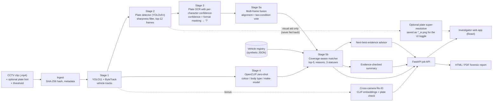
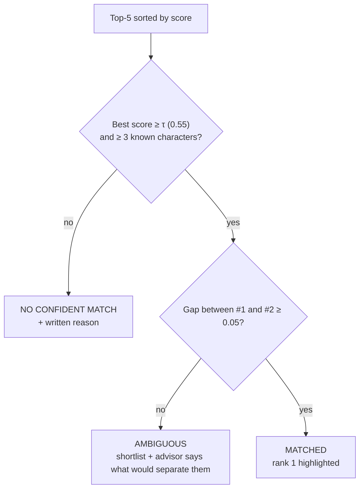

# PRISM: Proposed Solution

**Hackasol 5.0 · Track 2 (AIML) · Problem AIML-01 (Option A): Vehicle Identification and Traceability from CCTV Footage**

> **PRISM** = **P**late **R**ecovery & **I**dentification from **S**urveillance **M**edia
>
> Upload blurry CCTV footage and, optionally, the part of the plate you already know. PRISM returns a ranked top-5 list of registry vehicles. Each candidate has a confidence score, a reason for every point of that score, and links back to the exact frames the evidence came from. Characters PRISM can't read stay as `?`. It never guesses them.

---

## Contents

1. [Problem summary](#1-problem-summary)
2. [What makes PRISM different](#2-what-makes-prism-different)
3. [Design principles](#3-design-principles)
4. [System architecture](#4-system-architecture)
5. [The pipeline, stage by stage](#5-the-pipeline-stage-by-stage)
6. [Custom matching algorithm](#6-custom-matching-algorithm)
7. [Trustworthy language layer](#7-trustworthy-language-layer)
8. [Investigator web application](#8-investigator-web-application)
9. [Forensic report](#9-forensic-report)
10. [Bonus features](#10-bonus-features)
11. [Data: registry and test clips](#11-data-registry-and-test-clips)
12. [Evaluation plan](#12-evaluation-plan)
13. [Requirement coverage](#13-requirement-coverage)
14. [Technology stack and API](#14-technology-stack-and-api)
15. [Privacy, ethics and responsible use](#15-privacy-ethics-and-responsible-use)
16. [Risks and mitigations](#16-risks-and-mitigations)
17. [36-hour build plan](#17-36-hour-build-plan)
18. [Demo script for judges](#18-demo-script-for-judges)
19. [Research foundation](#19-research-foundation)

---

## 1. Problem summary

CCTV often records vehicles at road offences with plates that are blurred, partly hidden, damaged or unreadable. Investigators may know only part of the registration number, which makes the vehicle hard to identify and harder to follow across cameras.

The problem statement asks for a web or mobile application that analyses video and finds possible matching vehicles from a sample registry. It must use partial plate characters, vehicle colour and vehicle type, and return a ranked shortlist with visual evidence, step-by-step reasoning and a confidence score for each match.

**Must-have features**

| # | Feature | Requirement in the problem statement |
|---|---|---|
| M1 | Multi-frame plate recovery | Combine several frames. Characters that can't be read with high certainty are marked `?` and never invented. |
| M2 | Attribute extraction | Detect colour and body type (car, SUV, two-wheeler, auto-rickshaw, truck, and others) under varying lighting. |
| M3 | Registry matching and ranking | Top-5 shortlist with a total confidence score and clear reasons for each candidate. |
| M4 | No-match handling | Return "No Confident Match" instead of forcing a wrong candidate. |
| M5 | Investigator interface and report | Upload clips, review results, and export a PDF or HTML report with the frames used, the characters recovered per frame with confidence, and the full scoring breakdown. |

**Bonus features:** B1 make and model recognition. B2 cross-camera tracking across two clips.

**Key deliverables:** a working web application, a custom matching algorithm built by the team, and analysis reports for the test clips.

---

## 2. What makes PRISM different

Most teams will chain a detector to an OCR model and run a string search. PRISM goes further in eight ways, each tied to a requirement:

| # | Feature | Why it matters | Requirement |
|---|---|---|---|
| 1 | **Two-condition fusion vote.** A character is accepted only if its total evidence is strong and it clearly beats every alternative. If frames disagree, such as 8 vs B, the position stays `?`. | Mathematically rules out invented characters | M1 |
| 2 | **Indian plate format check that can only remove characters.** A letter where a digit must go becomes `?`. The check never fills a gap or changes a character. | Catches OCR errors without guessing | M1 |
| 3 | **Coverage-aware scoring.** Matching 3 known characters counts for less than matching 8, because many registry plates fit 3 characters. | Stops partial plates from looking falsely certain | M3, M4 |
| 4 | **Three result statuses:** `MATCHED`, `AMBIGUOUS` and `NO CONFIDENT MATCH`. | Distinguishes "two cars fit equally" from "nothing fits" | M4 |
| 5 | **Next-best-evidence advisor.** PRISM names the unknown plate position that would best separate the top candidates, and points to the frame that came closest to reading it. | Tells the investigator what to look for next | M3, M5 |
| 6 | **Plate evidence strip.** A visual showing, for every plate position, which frames voted for which character and how strongly. | Makes fusion visible to a non-expert judge | M1, M5 |
| 7 | **Chain of custody.** SHA-256 hashes of the clip and every saved crop, plus model versions and a config hash, all in the report. | Lets anyone check the report wasn't altered and rerun it with the same result | M5 |
| 8 | **Language summary checked against the evidence.** A plain-English summary in which every sentence cites an evidence ID and is checked against the result data before it's shown. | Fits the track's "Trustworthy Language AI" theme | M5 |

---

## 3. Design principles

1. **Never invent evidence.** Every character in the output was read with confidence in at least one real frame and survived the fusion vote. Super-resolution (sharpening by generating detail) appears only as a labelled visual aid for humans. It is never fed to OCR or scoring.
2. **Many weak frames beat one good guess.** A vehicle appears in dozens of frames, and each frame contributes the characters it reads well.
3. **Every number has a reason.** Each score breaks down into plate, colour, body-type and make/model parts, each with a written reason.
4. **Saying "I don't know" is a valid answer.** Uncertain attributes are reported as `uncertain` and give no credit. Weak evidence produces `NO CONFIDENT MATCH`.
5. **Human in the loop.** PRISM supports the investigator's decision and doesn't make it. Investigator input, such as a plate hint, is always labelled as investigator-supplied, separate from what the video showed.
6. **Use proven pre-trained models.** The team's own work is the fusion, matching, guardrails and explanations, which is what the problem rewards.
7. **Reproducible.** The same clip and config always give the same result. Seeds are fixed and every threshold is printed in the report.

---

## 4. System architecture



**Code layout** (one Python package that the API and the tests both use):

```text
PRISM/
├── prism/                     # Core library (no web code)
│   ├── config.py              # Every threshold and weight, in one place
│   ├── schemas.py             # Pydantic models for results and reports
│   ├── stages/
│   │   ├── track.py           # Stage 1: detection + tracking
│   │   ├── plate_detect.py    # Stage 2: plate detection + sharpness (wraps vendor/fast-alpr)
│   │   ├── ocr.py             # Stage 3: BasePlateOCR + ParseqOCR / FastPlateOCR
│   │   ├── super_res.py       # Optional visual aid only (wraps vendor/lpsr-lacd)
│   │   └── attributes.py      # Stage 4: OpenCLIP attributes
│   ├── plate_grammar.py       # Indian plate format rules
│   ├── masking.py             # Confidence + format masking
│   ├── fusion.py              # Stage 5a: multi-frame fusion
│   ├── matcher.py             # Stage 5b: scoring, ranking, statuses
│   ├── advisor.py             # Next-best-evidence advisor
│   ├── narrative.py           # Evidence-checked summary
│   ├── reid.py                # Bonus: BaseReIDEncoder + cross-camera matching
│   ├── custody.py             # Hashing and audit log
│   ├── report.py              # Jinja2 HTML + Playwright PDF
│   └── pipeline.py            # Runs everything, returns one result
├── backend/app/main.py        # FastAPI app
├── frontend/                  # React + Vite + Tailwind
├── data/                      # Registry generator + registry.json
├── scripts/                   # Degradation, evaluation, batch reports
├── tests/                     # pytest
├── docs/                      # This document, problem statement, blueprint
└── vendor/                    # Pre-cloned research repos (read-only, git-ignored)
    ├── fast-alpr/             # YOLOv9-t plate detector + fast-plate-ocr benchmark option
    ├── parseq/                # PARSeq transformer OCR, per-character softmax confidence
    ├── lpsr-lacd/             # Optional: plate super-resolution, UI visual aid only
    └── vehicle-reidentification/  # Optional: OSNet / ResNet Re-ID encoder
```

**Vendor rule.** Files inside `./vendor/` are never edited. Each repo is wrapped by a thin adapter in `prism/stages/` or `prism/reid.py`, so the rest of PRISM only sees PRISM's own interfaces (`BasePlateOCR`, `BaseReIDEncoder` and the stage functions). Updating or swapping a repo never touches fusion, matching or the guardrails. The commit hash of each vendor repo is recorded in the chain-of-custody section of every report (§9). The full repo-to-module mapping is in §14.

---

## 5. The pipeline, stage by stage

### Stage 0: Ingest
- PRISM computes the clip's SHA-256 hash before reading it, and records its resolution, FPS, duration and frame count.
- It measures each frame's mean brightness. If the median is below 60 out of 255, the clip is flagged as **low light**, which changes colour scoring (see §6.4).

### Stage 1: Vehicle detection and tracking
- **Models:** Ultralytics `yolo11s.pt` (`yolo11n.pt` on CPU) with `tracker="bytetrack.yaml"`. ByteTrack gives each vehicle one track ID that persists across frames.
- **Classes kept:** COCO `car`, `motorcycle`, `bus`, `truck`.
- **Crop padding:** 5%, so plates near the bumper aren't cut off.
- **Track filter:** tracks seen in fewer than 5 frames are dropped as noise.
- **Speed:** on CPU, PRISM processes every second frame, which ByteTrack handles without trouble.
- **Output per track:** frame indices, timestamps, boxes, detection confidence, crops, and when the vehicle was first and last seen.

### Stage 2: Plate detection and frame quality
- **Model:** fast-alpr's YOLOv9-t plate detector (`yolo-v9-t-384-license-plate-end2end`, ONNX). `prism/stages/plate_detect.py` wraps it from `vendor/fast-alpr`, or from the installed `fast-alpr[onnx-gpu]` package (`fast-alpr[onnx]` on CPU).
- **Search area:** the detector runs **only inside each Stage 1 vehicle crop**, never on the full frame. Each plate box is converted back to frame coordinates for the audit log. Searching inside the crop reduces false detections (signboards, other text) and saves time, and every plate is tied to exactly one track ID.
- **Sharpness:** the variance of the Laplacian of the greyscale plate crop:

  $$S_t = \mathrm{Var}\left(\nabla^2 I_t\right)$$

- **Filters:** drop crops with $S_t < 45$ or width under 30 px, then keep the **12 sharpest** frames per track.
- **Two-line plates:** Indian two-wheeler and many commercial plates have two rows of text. If a crop's width/height ratio is below 2.2, PRISM splits it into two rows at the horizontal gap in brightness. It reads each row and joins the results, top row first.
- **Contrast enhancement:** PRISM also reads a CLAHE-enhanced copy of each plate crop. CLAHE only rescales existing brightness. It doesn't generate strokes, so it can't invent a character. Each copy counts as its own vote and is labelled in the audit log.

### Stage 3: OCR that marks uncertain characters

**OCR interface.** `prism/stages/ocr.py` defines one interface so the team can benchmark two OCR models on the test set and keep the more accurate one:

```python
class BasePlateOCR(ABC):
    @abstractmethod
    def read(self, plate_crop: np.ndarray) -> tuple[str, list[float]]:
        """Return (raw_text, char_confidences), one confidence per character in raw_text."""
```

Two implementations:

- **`ParseqOCR`** wraps **PARSeq** ([Bautista & Atienza, ECCV 2022](https://arxiv.org/abs/2207.06966)), a transformer text reader that gives a softmax confidence for every character.
  - Loads from `vendor/parseq`, or from `torch.hub.load('baudm/parseq', 'parseq', pretrained=True)`.
  - Resizes and normalizes each crop to `model.hparams.img_size` (32 × 128 for the released weights).
  - Takes `probs = model(x).softmax(-1)`, then `labels, confs = model.tokenizer.decode(probs)`.
  - `confs` includes a final end-of-sequence probability. That entry is dropped, so `char_confidences` has exactly one entry per character in `raw_text`.
- **`FastPlateOCR`** wraps **fast-plate-ocr**, the plate-trained OCR that `vendor/fast-alpr` installs as a dependency, behind the same interface.
  - Uses its per-slot probability output.
  - Padding slots are dropped so text and confidences line up one to one.
  - Used for the day-1 benchmark in `scripts/evaluate.py`, which runs both models on the same plate crops and reports committed-character error and recovery rate for each (§12).

`config.py` selects the winner (`ocr.backend: parseq | fast_plate_ocr`). Both implementations return raw output only. **Neither applies any threshold itself.** Every result goes through `prism/masking.py`: a confidence below 0.70 or a non-alphanumeric character becomes `?`. Lowercase letters from PARSeq's general character set are converted to uppercase first. This doesn't change which letter was read, because Indian plates use only uppercase.

**Confidence masking.** For the character $\hat c_{t,k}$ at position $k$ in frame $t$, read with confidence $p_{t,k}$:

$$c_{t,k} = \begin{cases} \hat c_{t,k} & \text{if } p_{t,k} \ge 0.70 \text{ and } \hat c_{t,k} \in \{A\text{–}Z, 0\text{–}9\} \\ \texttt{?} & \text{otherwise} \end{cases}$$

**Format masking.** PRISM checks each reading against Indian plate formats:
- Standard: `SS D{1,2} L{1,3} DDDD`, e.g. `CG 04 MX 4821`, or `DL 1C AB 1234` for older Delhi plates.
- Bharat series: `YY BH DDDD L{1,2}`, e.g. `22 BH 1234 AA`.
- The state code must be on the list of valid codes (CG, MH, DL, KA, and so on).

A character that breaks the expected letter/digit pattern becomes `?`, and the conflict is logged. **The format check can turn a character into `?` but never adds or changes one.** A unit test enforces this.

**Audit record per frame:** the frame index, timestamp, sharpness, OCR backend, raw OCR string, masked string, per-character confidences, which copy was read (raw or CLAHE), and the URLs of the crop images.

### Optional visual aid: plate super-resolution (`prism/stages/super_res.py`)

This shows investigators a sharpened view of a blurry plate. **It is never evidence.**

- **Model:** `cgnetV2_deformable` from `vendor/lpsr-lacd` ([Nascimento et al., SIBGRAPI 2024](https://github.com/valfride/lpsr-lacd)), using the checkpoint the authors publish on GitHub Releases.
- **Pre-processing (matches the repo's config):**
  - pad the low-resolution plate crop with grey `(127, 127, 127)` to a 3:1 width-to-height ratio;
  - resize it to 16 × 48 (height × width).
- **Output:** a 2× upscaled image, saved **only** as `/artifacts/track{id}_f{frame}_sr.png`.
- **Missing weights:** if the checkpoint isn't present, `super_res.py` logs a warning and turns itself off. The UI toggle shows "Super-resolution not installed", and the rest of the pipeline is unaffected.

> **Guardrail.** Super-resolution output goes to the UI's "Visual aid only. Not used for identification." toggle and nowhere else. It is **never** fed into OCR, fusion, matching, the advisor or the summary.
>
> **How this is enforced:**
> - `super_res.py` is called only by the artifact writer, after Stage 3 has finished.
> - The OCR stage accepts only crops tagged `source="raw"` or `source="clahe"`.
> - A unit test checks that no `*_sr.png` path, and no array produced by `super_res.py`, ever reaches `BasePlateOCR.read`.
>
> **Why:** super-resolution can draw convincing strokes that weren't in the footage, and this model was trained on Brazilian plates, not Indian ones. Feeding it to OCR would break the "never invent characters" rule.

### Stage 4: Vehicle attributes
- **Model:** OpenCLIP `ViT-B-32` with the `laion2b_s34b_b79k` weights, used zero-shot by comparing images to text prompts.
- **Input:** the 3 sharpest vehicle crops of each track. PRISM averages the probabilities across the 3 crops so glare or a shadow in one frame has less effect.
- **Prompt ensembles:** each label uses several phrasings, such as "a CCTV photo of a white car", "a white vehicle at night" and "a white vehicle on a road", and their embeddings are averaged. This is a standard way to make CLIP more reliable.

| Attribute | Labels |
|---|---|
| Colour | white, black, silver, grey, red, blue, green, yellow, brown, orange |
| Body type | car (from the hatchback and sedan prompts), SUV, two-wheeler, auto-rickshaw, truck, bus |

- **Combining with the detector:** body type uses both the YOLO class and CLIP's answer. CLIP is allowed to override YOLO, because COCO has no auto-rickshaw class and YOLO labels them "car" or "motorcycle".
- **Uncertain results:** if the top probability is below 0.40, the attribute is reported as `uncertain` with its two most likely values, and it adds nothing to the score.

---

## 6. Custom matching algorithm

This is the part the team designs itself. It has five steps.

### 6.1 Multi-frame fusion (`fusion.py`)

1. **Line up the readings.** Take the most common reading length $L$. Use the most confident reading of that length as the reference. Line up every other reading against it with edit-distance alignment, where `?` matches anything. This handles frames where the first or last character was cut off.
2. **Weigh the evidence.** For each position $k$ and character $a$:

   $$W_k(a) = \sum_{t \in \mathcal{T}} \mathbb{I}(c_{t,k} = a)\cdot p_{t,k}\cdot \min\!\left(\frac{S_t}{100},\, 2.0\right)$$

   Sharper frames count more. The cap of 2.0 stops one very sharp frame from outvoting everything else.
3. **Two-condition vote.** Let $a^* = \arg\max_a W_k(a)$. Then:

   $$c^*_k = \begin{cases} a^* & \text{if } W_k(a^*) \ge 0.9 \text{ and } \dfrac{W_k(a^*)}{\sum_a W_k(a)} \ge 0.60 \\ \texttt{?} & \text{otherwise} \end{cases}$$

   - The first condition requires about one sharp frame with a high-confidence reading.
   - The second requires the winner to hold most of the evidence.
   - If frames disagree (8 vs B), neither condition is guaranteed, so the position stays `?`.
4. **Output:**
   - the combined plate, e.g. `CG04?X48?1`;
   - a confidence for each position, $W_k(a^*) / \sum_a W_k(a)$;
   - for each position, the frames that supported the winner and the frames that disagreed. This data drives the evidence strip in the UI.

> **Guarantee:** every character in the combined plate was read with at least 0.70 confidence in at least one real frame. Property-based tests check this.

### 6.2 Investigator hint (optional)
The investigator can enter a partial plate, such as `CG04??48??`.
- Where the video shows `?` and the hint has a character, the hint fills the position, and it's labelled **investigator-supplied** in the UI and report.
- Where the video and the hint disagree, the position becomes `?` and the conflict is listed in the reasons.
- With no clip, PRISM can run a **hint-only search** using the hint plus a chosen colour and body type.

### 6.3 Plate similarity
Let $\mathcal{K}$ be the set of known (non-`?`) positions in the combined plate $P_v$. For a registry plate $P_r$:

$$\mathrm{Sim}_{\text{plate}} = \max_{\delta\in\{-1,0,1\}} \left[\frac{1}{|\mathcal{K}|}\sum_{k\in\mathcal{K}} m\big(P_v[k],\,P_r[k+\delta]\big)\right] - 0.05\,|\delta|$$

where $m(x, y)$ is:
- **1.0** if the characters are equal;
- **0.35** if they're a common CCTV OCR mix-up: `0/O`, `1/I`, `8/B`, `5/S`, `2/Z`, `6/G`, `4/A`;
- **0** otherwise, or if $k+\delta$ falls outside the plate.

Trying shifts of −1, 0 and +1 handles a lost first or last character. The 0.05 penalty means an unshifted match wins a tie. Registry plates more than 1 character longer or shorter score 0.

**Coverage factor.** Three matching characters are consistent with many registry plates, so they're weak evidence. PRISM scales the plate score by how many characters are known:

$$\mathrm{Plate} = \mathrm{Sim}_{\text{plate}} \times \min\!\left(1,\ \frac{|\mathcal{K}|}{6}\right)$$

PRISM also reports **specificity**: how many registry entries fit the known characters exactly, e.g. "3 of 500 registry plates fit `CG04?X48?1`".

### 6.4 Composite score

$$\mathrm{Score} = w_p\cdot\mathrm{Plate} + w_c\cdot\mathrm{Sim}_{\text{colour}} + w_b\cdot\mathrm{Sim}_{\text{body}} + 0.05\cdot\mathrm{MM}$$

| Part | Value |
|---|---|
| Weights | $w_p = 0.65$, $w_c = 0.20$, $w_b = 0.15$ |
| Colour | 1.0 exact; 0.5 for similar shades under CCTV (silver/grey, white/silver, grey/black at night); 0 otherwise; 0 if uncertain |
| Body type | 1.0 if the category matches; 0 otherwise; 0 if uncertain |
| Make/model (MM) | 1 if a confident (≥0.50) make/model prediction matches the registry entry, otherwise 0. Only breaks ties. |
| Low light | If the clip is flagged low light, $w_c$ drops to 0.10 and $w_p$ rises to 0.75, and the reasons say so |

The score is clipped to [0, 1].

### 6.5 Guardrails and statuses

| Rule | Effect |
|---|---|
| No readable plate characters ($\lvert\mathcal{K}\rvert = 0$) | Score capped at 0.45. Colour and body type alone can never produce a match. |
| Fewer than 3 known characters | `MATCHED` is not allowed |
| Make/model bonus | Can't lift a candidate over the threshold by itself |
| A known character contradicts the registry plate with no shift that fixes it | The reason lists it as a **mismatch**, not just a lower score |

PRISM always returns the top 5, sorted by score, with one of three statuses:



The threshold τ defaults to 0.55 and the investigator can change it with a slider. The default is set from evaluation data so that the false-match rate stays under 5% (§12).

**Example `NO CONFIDENT MATCH` reason:**
> Best candidate REG-0217 scored 0.37, below the 0.55 threshold. Only 2 plate characters were readable (positions 1 and 2), so plate evidence counts for at most 0.22, and at least 3 known characters are needed for a match. Colour was uncertain (silver 0.34, grey 0.31), so it added nothing.

**Example reasons for one candidate:**
> - **Plate (0.60 of 0.65):** 7 of 8 known characters match. Position 8 shows `8` in the video and `B` in the registry, a known OCR mix-up given partial credit. Positions 5 and 9 are unknown.
> - **Colour (0.20 of 0.20):** exact match (white, 0.87).
> - **Body type (0.15 of 0.15):** exact match (SUV, 0.91).
> - **Make/model (+0.05):** Hyundai Creta (0.68) matches the registry.
> - **Specificity:** 3 of 500 registry plates fit the known characters.

### 6.6 Next-best-evidence advisor (`advisor.py`)
When the result is `AMBIGUOUS` or `NO CONFIDENT MATCH`, the advisor looks at the top candidates' characters at each unknown position. It picks the position where the candidates differ most, weighted by their scores.

It then finds the frame that came closest to reading that position, meaning the highest confidence that was still below 0.70. It shows that frame as a **lead, not evidence**:

> Position 5 separates the top two: REG-0001 has `M`, REG-0417 has `N`. Frame 57 read it as `M` at 0.62, below the 0.70 threshold, so it wasn't used. Check frame 57 by eye, or look for footage from another angle.

This turns uncertainty into a next step for the investigator. Nothing it suggests ever enters the score.

---

## 7. Trustworthy language layer

Track 2 is titled "Computer Vision and **Trustworthy Language AI**". PRISM writes a short plain-English summary for each case and makes sure every sentence is backed by evidence.

1. **Input:** only the structured result data. The language step never sees raw video and gets no extra knowledge.
2. **Generation:**
   - **Default:** a fixed template that runs offline every time.
   - **Optional:** a small local LLM through Ollama, such as Llama 3.2 3B or Qwen2.5 3B, told to cite an evidence ID (`[F42]`, `[REG-0001]`, `[POS-5]`) in every sentence.
3. **Checking:** a rule-based checker extracts every plate string, number, registry ID and frame index from each sentence and compares them with the result data. Any sentence with something unsupported or uncited is removed. If more than one sentence fails, PRISM falls back to the template.
4. **Labelling:** the UI and report show which method produced the summary and how many sentences were checked.

Example output:
> Vehicle track 4 (white SUV, seen 00:01.4–00:04.2) showed a partial plate `CG04?X48?1` across 9 frames [F42, F47, F51]. The best registry candidate is REG-0001, `CG04MX4821` [REG-0001], scoring 1.00 with 8 of 8 known characters matching. Position 5 was never read with confidence [POS-5].

---

## 8. Investigator web application

The UI is a **React + Vite + Tailwind** single-page app, served by FastAPI in production so the demo needs only one command. Screens:

1. **New case**
   - Drag and drop one clip, or two for cross-camera mode.
   - Optional plate hint with a mask helper (`CG04??48??`).
   - Threshold slider and a CPU/GPU indicator.
2. **Live progress:** a progress bar for each stage (tracking, plates, OCR, attributes, matching), streamed from the job API.
3. **Vehicles found:** a grid of track cards. Each shows the best crop, the combined plate with `?` positions in amber and investigator-supplied characters in blue, colour and body-type chips with confidence, and the times the vehicle was first and last seen.
4. **Evidence view for one track**
   - **Plate evidence strip:** one column per plate position and one row per frame. Each cell shows the character read, shaded by weight, with a bar on top for the winning share.
   - **Frame-by-frame table:** frame thumbnail, plate crop (raw and CLAHE), sharpness, raw OCR string, masked string, and confidence pills per character.
   - **Super-resolution preview** (optional, §5), behind a toggle labelled "Visual aid only. Not used for identification." It shows the saved `*_sr.png` next to the raw crop, or "Super-resolution not installed" if the weights are missing.
5. **Shortlist**
   - Top-5 cards with a score bar split into plate, colour, body and make/model portions.
   - Match and mismatch badges, plus the specificity count.
   - A status banner: green `MATCHED`, amber `AMBIGUOUS` or red `NO CONFIDENT MATCH`.
   - The advisor panel.
6. **Summary and export:** the checked summary, plus buttons to **download PDF** and **download HTML**.
7. **Cross-camera tab:** clip A tracks next to clip B tracks, with matched pairs linked by similarity and plate-compatibility badges.

---

## 9. Forensic report

PRISM builds the report from a Jinja2 HTML template. PDFs are printed with headless Chromium through Playwright. This was chosen over WeasyPrint, which needs GTK libraries that are hard to install on Windows.

**Report sections**
1. **Case header:** case ID, date and time, investigator hint (if given), PRISM version.
2. **Chain of custody:**
   - SHA-256 of the clip, plus clip metadata;
   - model names and versions, the OCR and Re-ID backends used, and the git commit hash of each `vendor/` repo;
   - a hash of the config, with the full threshold table;
   - a SHA-256 for every saved crop image.
3. **Summary:** the checked summary with evidence IDs.
4. **For each vehicle track:**
   - the best crop, attributes with confidence, and first/last-seen times;
   - the **frames used** table: frame, timestamp, sharpness, plate crop, raw and masked OCR, and confidence per character;
   - the plate evidence strip as an image;
   - the combined plate with a confidence for each position.
5. **Scoring breakdown:**
   - each of the top 5 with its score split into parts;
   - reasons, mismatches and specificity;
   - status and threshold used.
6. **Advisor notes.**
7. **Limitations statement:** "PRISM output supports an investigator's decision. It does not identify a vehicle on its own."

**Batch reports.** `scripts/batch_report.py` processes every clip in `data/test_clips/` and writes one report per clip plus an index page. This produces the "Analysis Reports for test clips" deliverable directly.

---

## 10. Bonus features

### B1. Make and model recognition
- A second OpenCLIP prompt list of about 30 common Indian models:
  - **Cars and SUVs:** Maruti Swift, Baleno, Alto, Dzire, Ertiga; Hyundai Creta, i20, Venue; Tata Nexon, Punch; Mahindra Scorpio, Bolero, XUV700, Thar; Toyota Innova; Kia Seltos.
  - **Two-wheelers:** Honda Activa; Hero Splendor; Bajaj Pulsar; Royal Enfield Classic 350.
  - **Auto-rickshaws:** Bajaj RE auto-rickshaw.
  - **Commercial vehicles:** Tata Ace.
- PRISM only predicts models that fit the detected body type. A two-wheeler can't be labelled a Creta.
- A confident prediction (≥0.50) adds **+0.05** as a tie-breaker. Below that, the UI shows "make/model uncertain" and the score doesn't change.

### B2. Cross-camera tracking (`reid.py`)
- **Encoder interface:** `prism/reid.py` defines one interface for turning a track's crops into a single appearance vector:

  ```python
  class BaseReIDEncoder(ABC):
      @abstractmethod
      def encode(self, crops: list[np.ndarray]) -> np.ndarray:
          """Return one L2-normalized embedding for a track (averaged over its crops)."""
  ```

  Two implementations, chosen in `config.py` (`reid.encoder: clip | osnet | resnet`):

  - **`ClipReIDEncoder` (default):** a 512-dimension OpenCLIP `ViT-B-32` image embedding for each of the track's 3 sharpest crops, averaged and normalized.
  - **`VendorReIDEncoder` (optional):** wraps the OSNet (torchreid, Re-ID pre-trained) or ImageNet ResNet feature extractor from `vendor/vehicle-reidentification`, with the same averaging and normalizing.
    - Each encoder has its own similarity threshold in `config.py`, because cosine scores aren't comparable between models.
    - 0.82 is the CLIP threshold. An OSNet or ResNet threshold must be set from the evaluation clips before that encoder is used in a demo.
    - If the vendor repo or its weights are missing, PRISM logs a warning and falls back to `ClipReIDEncoder`.
- **Same vehicle** when all of these hold:
  1. cosine similarity ≥ the selected encoder's threshold (**0.82** for the default CLIP encoder);
  2. **plate compatibility:** no known position conflicts between the two combined plates, apart from known OCR mix-ups;
  3. matching body type.

  Checks 2 and 3 apply whichever encoder is selected. Appearance similarity alone can never link two tracks.
- **Optional time check:** if the investigator enters the cameras' distance and the time between clips, PRISM flags pairs that would need an impossible speed (over 120 km/h in a city).
- **Combined evidence:** the two tracks' plate readings are fused together. Camera B may read the positions camera A couldn't, which can turn an `AMBIGUOUS` result into `MATCHED`. **This is the strongest demo moment for the bonus.**

---

## 11. Data: registry and test clips

### Synthetic registry (`data/generate_registry.py`)
- 500 records with a fixed random seed. Schema: `registry_id`, `plate`, `color`, `body_type`, `make`, `model`, `owner_region`. All owner data is synthetic.
- Realistic plates from Chhattisgarh (CG04 Raipur, CG07 Durg), Maharashtra (MH12, MH01), Delhi (DL01–DL14), Karnataka (KA01, KA05), plus Bharat-series (BH) plates.
- Make and model fix the body type, and colours follow realistic frequencies (white and silver are the most common).
- **Near-duplicate decoys:** for each demo vehicle, 3–5 entries that share most plate characters but differ in one confusable position, colour or body type. These show that PRISM ranks on more than the plate string.

### Test clips
1. **Team-recorded clips:** the team films 10–15 short clips of vehicles they know (their own or friends', with permission) from a raised position, by day and at night. Those plates are added to the registry, so the correct answer is known.
2. **Public traffic footage:** used for detection and tracking demos.
3. **Degraded versions** (`scripts/make_degraded.py`): Gaussian and motion blur, 2× and 4× downscaling, JPEG quality 20, sensor noise and darkening. Each clip becomes 6 harder versions for the evaluation.

---

## 12. Evaluation plan

`scripts/evaluate.py` runs every test clip and degraded version and writes a metrics table into the README and the report index.

| Metric | What it measures | Target |
|---|---|---|
| **Committed-character error rate** | Share of non-`?` characters that are wrong | **≤ 1%**: shows PRISM doesn't invent characters |
| Character recovery rate | Share of true characters recovered (not `?`) | As high as possible; reported for each degradation level |
| Top-1 / top-5 accuracy | True vehicle ranked 1st / in the top 5 | ≥ 70% / ≥ 90% on the clean set |
| **False-match rate** | Rerun with the true vehicle **removed** from the registry; count how often PRISM still says `MATCHED` | **≤ 5%**; this test sets τ |
| Colour / body-type accuracy | Against hand labels | Reported for day and night separately |
| Processing time | Seconds per 30 s clip | GPU < 60 s, CPU < 5 min (targets) |

**Ablation table.** This shows the judges the value of each idea:

| Variant | Committed error | Top-5 | False-match |
|---|---|---|---|
| Best single frame, no fusion | – | – | – |
| Majority vote, no confidence masking | – | – | – |
| + confidence masking | – | – | – |
| + two-condition vote | – | – | – |
| + format check + coverage factor (full PRISM) | – | – | – |

The table is filled in by `evaluate.py`. The numbers above are targets, not results.

**Choosing τ.** PRISM plots false-match rate against top-1 accuracy as τ changes, and picks the lowest τ that keeps false matches at or under 5%. The plot goes in the README.

---

## 13. Requirement coverage

| Requirement | Where it's met | How it's shown |
|---|---|---|
| M1 Multi-frame recovery, never invent | Stages 2–3, §6.1 fusion, format check | Evidence strip, frames table, committed-error metric, property tests |
| M2 Colour and body type under varying light | Stage 4 prompt ensembles, crop averaging, low-light handling | Attribute chips with confidence, day/night accuracy |
| M3 Top-5, total score, reasons | §6.3–6.5 | Shortlist cards with score breakdown |
| M4 No Confident Match | §6.5 guardrails and three statuses | Red banner, false-match test |
| M5 Upload, review, report with frames, characters, scoring | §8 UI, §9 report | One-click PDF/HTML |
| B1 Make and model | §10 B1 | Make/model chip, tie-breaker reason |
| B2 Cross-camera | §10 B2 | Cross-camera tab, combined-evidence upgrade |
| Deliverable: working web app | React + FastAPI | Live demo |
| Deliverable: custom matching algorithm | `fusion.py`, `matcher.py`, `advisor.py` | §6 and tests |
| Deliverable: analysis reports for test clips | `batch_report.py` | `reports/index.html` |

---

## 14. Technology stack and API

| Layer | Choice |
|---|---|
| Language | Python 3.11 |
| Detection and tracking | Ultralytics YOLO11 + ByteTrack |
| Plate detection | fast-alpr (YOLOv9-t, ONNX Runtime) |
| OCR | PARSeq or fast-plate-ocr, whichever wins the benchmark |
| Attributes, make/model, Re-ID | OpenCLIP ViT-B-32 |
| Image processing | OpenCV, NumPy, Pillow |
| Backend | FastAPI, Pydantic v2, background job worker |
| Frontend | React, Vite, Tailwind CSS |
| Reports | Jinja2, Playwright (Chromium) |
| Language layer (optional) | Ollama with a 3B local model; a template is the default |
| Testing | pytest, Hypothesis (property-based tests) |

**Pre-cloned research repositories (`./vendor/`)**

All four are read-only and wrapped by PRISM adapters (§4). Ultralytics and OpenCLIP are installed from pip and aren't vendored.

| Repo | PRISM module | Role | Required? | If missing or weights absent |
|---|---|---|---|---|
| `vendor/fast-alpr` ([ankandrew/fast-alpr](https://github.com/ankandrew/fast-alpr)) | `prism/stages/plate_detect.py`, `prism/stages/ocr.py` (`FastPlateOCR`) | YOLOv9-t plate detector inside vehicle crops; fast-plate-ocr as the OCR benchmark option | **Yes** (detector) | Fall back to the pip package `fast-alpr[onnx-gpu]` / `fast-alpr[onnx]`. If neither is available, the pipeline stops with a clear setup error. It never runs without plate detection. |
| `vendor/parseq` ([baudm/parseq](https://github.com/baudm/parseq)) | `prism/stages/ocr.py` (`ParseqOCR`) | Transformer OCR with per-character softmax confidence | **Yes**, unless `FastPlateOCR` wins the benchmark | Load through `torch.hub`. If that also fails, switch to `FastPlateOCR` and record the backend in the report. |
| `vendor/lpsr-lacd` ([valfride/lpsr-lacd](https://github.com/valfride/lpsr-lacd)) | `prism/stages/super_res.py` | `cgnetV2_deformable` 2× plate super-resolution, **UI visual aid only** | No | Super-resolution turns itself off and the UI toggle shows "not installed". Results are identical either way, because super-resolution never affects them. |
| `vendor/vehicle-reidentification` ([kHarshit/vehicle-reidentification](https://github.com/kHarshit/vehicle-reidentification)) | `prism/reid.py` (`VendorReIDEncoder`) | Optional OSNet / ResNet appearance encoder for cross-camera matching | No | Fall back to the default `ClipReIDEncoder` (512-d OpenCLIP) with its 0.82 threshold. |

**Setup:**

```powershell
New-Item -ItemType Directory -Force vendor | Out-Null
git clone https://github.com/ankandrew/fast-alpr.git vendor/fast-alpr
git clone https://github.com/baudm/parseq.git vendor/parseq
git clone https://github.com/valfride/lpsr-lacd.git vendor/lpsr-lacd
git clone https://github.com/kHarshit/vehicle-reidentification.git vendor/vehicle-reidentification
```

`vendor/` is listed in `.gitignore`. Check each repo's licence before redistributing its code or weights. The `lpsr-lacd` training data (RodoSol-SR) is licensed for academic, non-commercial use only.

**API**

| Method | Path | Purpose |
|---|---|---|
| `POST` | `/api/jobs` | Upload a clip with an optional hint and threshold; returns `job_id` |
| `GET` | `/api/jobs/{job_id}` | Status, stage progress and result |
| `POST` | `/api/jobs/{job_id}/rescore` | Rescore with a new threshold or hint without rerunning the vision stages |
| `POST` | `/api/search` | Hint-only registry search |
| `POST` | `/api/crosscam` | Two clips → matched pairs |
| `GET` | `/api/report/{job_id}?format=pdf\|html` | Download the report |
| `GET` | `/artifacts/{path}` | Saved crops and frames |
| `GET` | `/health` | Device, model and version info |

`/rescore` lets the investigator move the threshold slider and see the result update instantly, because only the matcher reruns.

---

## 15. Privacy, ethics and responsible use

- **Decision support only.** Every screen and report says PRISM produces leads, not identifications.
- **Synthetic registry.** No real owner data is used. Team-recorded clips use vehicles with the owners' consent.
- **Runs locally.** All models run on the investigator's machine, and no footage is sent to a cloud service.
- **Least data.** PRISM saves only vehicle and plate crops, not full frames, unless the investigator exports them. Job data can be deleted from the UI.
- **Audit trail.** Every run records its inputs, config and outputs with hashes, so the result can be checked and repeated.
- **Bias check.** Evaluation reports accuracy separately for day and night and for each body type, so weak spots are visible instead of averaged away.

---

## 16. Risks and mitigations

| Risk | Mitigation |
|---|---|
| PARSeq was trained on general text, not Indian plates | OCR is swappable: benchmark against fast-plate-ocr on day 1 and keep the more accurate one |
| Real CCTV is worse than test clips | Degraded test versions; a 0.70 confidence cutoff; the system defaults to `?` and `NO CONFIDENT MATCH` |
| Two-line plate splitting fails | Fall back to reading the whole crop. Since masking still applies, a bad split only produces more `?`, never wrong characters |
| Night glare breaks colour | Prompt ensembles, crop averaging, similar-shade credit, reduced colour weight in low light, `uncertain` result |
| Auto-rickshaws missing from COCO | CLIP body-type override |
| Slow on CPU | YOLO11n, every second frame, OCR only on the 12 sharpest frames, cached CLIP text embeddings |
| Hand-picked thresholds | One config file, chosen from the evaluation sweep, adjustable in the UI, printed in the report |
| Demo-day failure (Wi-Fi, GPU, model download) | Model weights downloaded ahead of time, a pre-computed demo case built in, and a recorded backup video |

---

## 17. 36-hour build plan

This assumes a team of 4. Adjust if your team is a different size.

| Role | Owns |
|---|---|
| **A: Vision** | Stages 1–2, two-line splitting, CLAHE |
| **B: OCR and fusion** | Stage 3, masking, format check, `fusion.py`, OCR benchmark |
| **C: Matching and backend** | Registry generator, `matcher.py`, `advisor.py`, FastAPI, reports, custody |
| **D: Frontend and demo** | React app, evidence strip, cross-camera tab, pitch deck, demo video |

| Hours | Milestone |
|---|---|
| 0–3 | Repo setup, weights downloaded, test clips recorded, schemas and config agreed, registry generated |
| 3–10 | Stages 1–3 running on one clip; matcher passing unit tests with fake OCR data; UI shell built with mock JSON |
| 10–16 | Fusion and format check done; Stage 4 attributes; full pipeline returns real results through the API |
| 16–22 | UI connected to the live API; HTML/PDF report; three statuses and advisor |
| 22–28 | Bonus features: make/model, cross-camera; checked summary |
| 28–32 | Evaluation run, ablation table, threshold sweep, batch reports |
| 32–36 | Bug fixes only, README, pitch rehearsal, backup demo video |

**Code freeze at hour 32.** After that, only fixes.

---

## 18. Demo script for judges

A **5-minute** demo with three prepared cases:

1. **Clear match (60 s).** Upload a daytime clip. Show the live progress, the evidence strip filling with `?` positions, the green `MATCHED` banner, and a breakdown that adds up to the score.
2. **Partial plate with decoys (90 s).** Upload a blurred night clip whose combined plate is `CG04?X48?1`. Show the `AMBIGUOUS` result: two candidates differ only at position 5. Show the advisor pointing to frame 57. Upload the second camera's clip. The combined evidence fills position 5 and the result becomes `MATCHED`. *This is the strongest moment of the demo.*
3. **No match (45 s).** Remove the true vehicle from the registry and rerun. PRISM returns the red `NO CONFIDENT MATCH` banner with a written reason. Say: *"PRISM would rather say 'I don't know' than accuse the wrong owner."*
4. **Report and proof (45 s).** Download the PDF. Show the frames table, the scoring breakdown, the chain-of-custody hashes and the checked summary. Then show the ablation table: the committed-character error rate drops close to zero once masking and the two-condition vote are added.

---

## 19. Research foundation

| Work | How PRISM uses it |
|---|---|
| Bautista & Atienza, *Scene Text Recognition with Permuted Autoregressive Sequence Models* (PARSeq), ECCV 2022 | Per-character confidences make `?` masking possible |
| Zhang et al., *ByteTrack: Multi-Object Tracking by Associating Every Detection Box*, ECCV 2022 | Stable track IDs through occlusion, so frames can be combined per vehicle |
| Radford et al., *Learning Transferable Visual Models From Natural Language Supervision* (CLIP), ICML 2021; Cherti et al., *Reproducible Scaling Laws for Contrastive Language-Image Learning* (OpenCLIP), CVPR 2023 | Zero-shot colour, body type and make/model; prompt ensembles; Re-ID embeddings |
| Tian et al., *A Dynamic Transformer Network for Vehicle Detection*, arXiv:2506.02765, 2025 | Supports pairing CNN localization with attention models under occlusion and CCTV angles |
| Nascimento et al., *Super-resolution of license plate images using attention modules and sub-pixel convolution layers*, Computers & Graphics 113, 2023; Hamdi et al., *A New Image Enhancement and Super Resolution technique for license plate recognition*, Heliyon 7, 2021 | Plate super-resolution works but can create plausible fake strokes, which is why PRISM uses it only as a visual aid |
| Nascimento et al., *Enhancing License Plate Super-Resolution: A Layout-Aware and Character-Driven Approach*, SIBGRAPI 2024 (`vendor/lpsr-lacd`) | Source of the `cgnetV2_deformable` model behind PRISM's optional visual-aid super-resolution |
| Zhou et al., *Omni-Scale Feature Learning for Person Re-Identification* (OSNet), ICCV 2019, through `vendor/vehicle-reidentification` | Optional alternative appearance encoder for cross-camera matching |
| Rachmadi & Purnama, *Vehicle Color Recognition using Convolutional Neural Network*, arXiv:1510.07391, 2015 | Learned features beat colour histograms under surveillance lighting, which supports using CLIP over HSV rules |

---

*Companion documents in this repository: `Problem Statement & Proposed Solution.docx` (the official problem statement) and `aiml_01_master_blueprint_ai_agent_handoff.md` (the original technical blueprint). Where this document and the blueprint differ, this document is the final version.*
